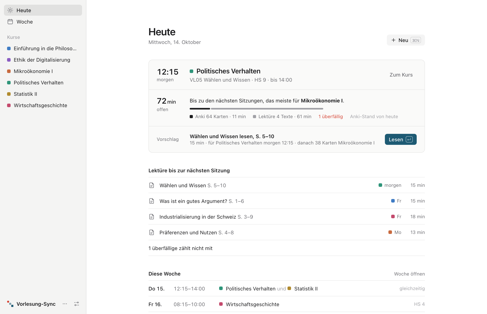
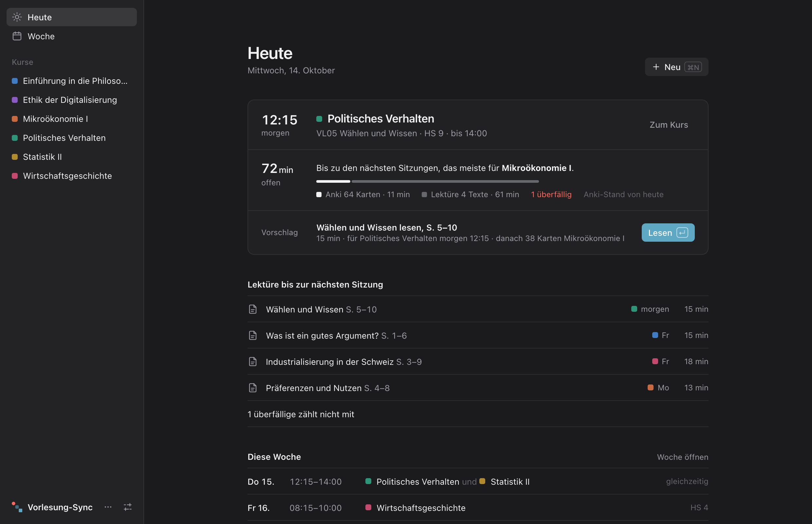
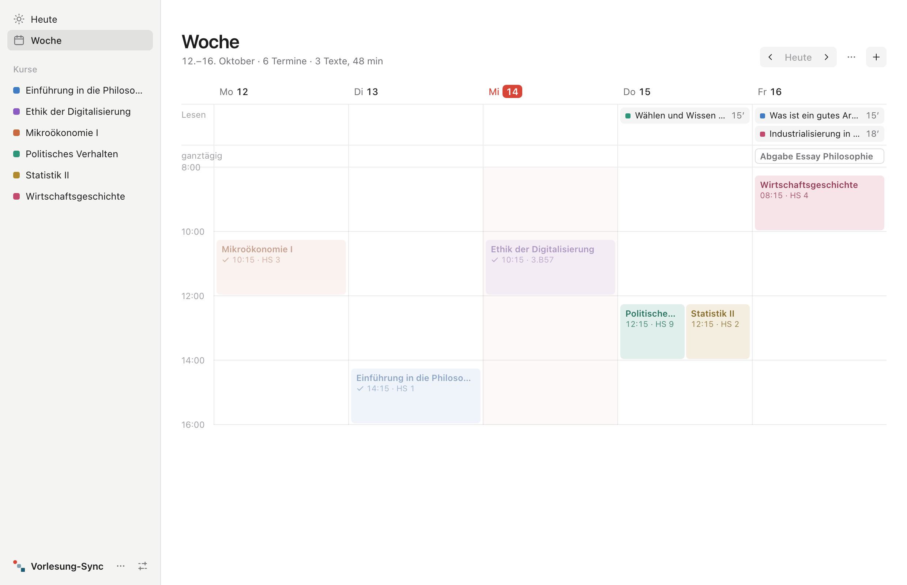
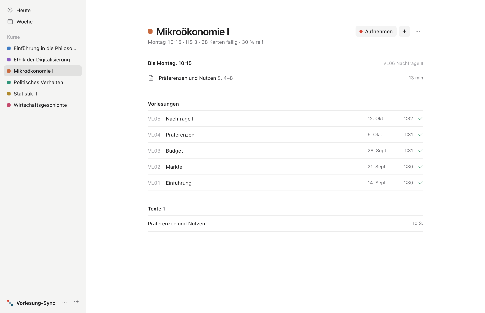
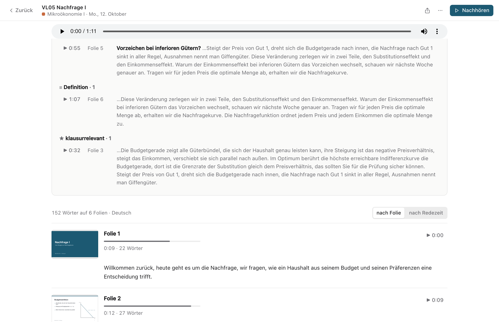
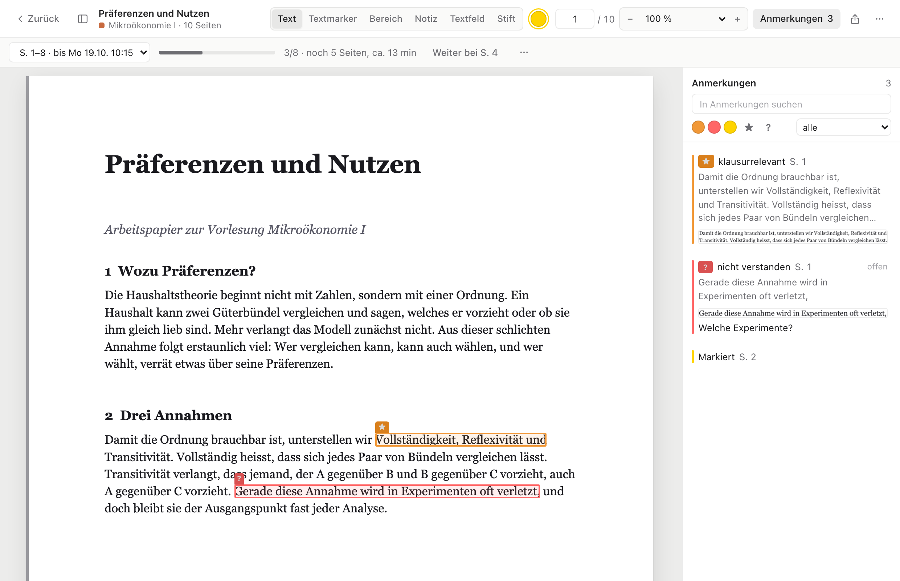

# Morpha

Das Gedächtnis deines Studiums: Stundenplan, Vorlesungen, Texte und Lernkarten an einem
Ort. Vorlesungen aufnehmen und mit den Folien verknüpfen, Stellen markieren
(★ klausurrelevant, ? nicht verstanden, ≡ Definition), Pflichtlektüre mit Fristen lesen.
Nach der Vorlesung transkribiert die App lokal mit Whisper und ordnet jeden Satz seiner
Folie zu. Morpha hält so deinen **Lernstand** und gibt ihn weiter an Anki und, wenn du
willst, an deinen **KI-Assistenten** (zum Beispiel Claude), der dich abfragt und einträgt,
was sich geklärt hat. Nichts verlässt den Rechner, ausser was du dem Assistenten im
Gespräch selbst zeigst.

Hier liegen die fertigen Versionen für Mac und Windows; die App aktualisiert sich von hier.
Bis 0.9 hiess sie **Vorlesung-Sync** – siehe [Von Vorlesung-Sync zu Morpha](#von-vorlesung-sync-zu-morpha).



*Bilder mit erfundenen Kursen. Die Anleitung beschreibt die Oberfläche ab 0.9.0; ältere
Versionen hatten eine Startseite mit Kacheln.*

**Inhalt:** [Herunterladen](#herunterladen) · [Installieren](#installieren) ·
[Einrichtung, Einstellungen und Hilfe](#einrichtung-einstellungen-und-hilfe) ·
[So geht’s](#so-gehts) · [Heute, Woche und Kurse](#heute-woche-und-kurse) ·
[Aufnehmen](#aufnehmen) · [Auswertung](#auswertung) · [Nachhören](#nachhören) · [Teilen](#teilen) ·
[Lektüre und Reader](#lektüre-und-reader) · [Karten und Lernfortschritt](#karten-und-lernfortschritt) ·
[Updates und Daten](#updates-und-daten) · [Von Vorlesung-Sync zu Morpha](#von-vorlesung-sync-zu-morpha) ·
[Mit KI und Anki lernen](#mit-ki-und-anki-lernen)

## Herunterladen

Unter [Releases → neueste Version](https://github.com/timix0513/morpha-releases/releases/latest):

| Datei | wofür |
|---|---|
| `Morpha-<v>-mac.dmg` | Mac (Apple Silicon), zum Installieren |
| `Morpha-<v>-windows-setup.exe` | Windows, zum Installieren |
| `Morpha-<v>-mac.zip` | nur für die Updates der App, nicht von Hand nötig |

## Installieren

**Mac:** Die `.dmg` öffnen, Morpha in „Programme“ ziehen und von dort starten
(aus „Downloads“ heraus funktionieren die Updates nicht). Die App ist nicht bei Apple
notarisiert, deshalb meldet macOS beim ersten Öffnen, sie sei nicht überprüft:
Systemeinstellungen → Datenschutz & Sicherheit → ganz unten „Dennoch öffnen“.

**Windows:** Den Installer ausführen, Adminrechte braucht er nicht. Windows SmartScreen
zeigt einmal eine Warnung: „Weitere Informationen“ → „Trotzdem ausführen“. Die
Transkription läuft unter Windows auf der CPU und ist deutlich langsamer als auf dem Mac.

Beim ersten Start führt ein Assistent durch die Einrichtung (siehe unten). Beim ersten
Aufnehmen fragt die App nach dem Mikrofon. Das Whisper-Modell (Standard
`large-v3-turbo`, 1.6 GB) lädt sie bei der ersten Transkription einmalig herunter.

## Einrichtung, Einstellungen und Hilfe

**Einrichtung.** Beim ersten Start kommt eine Checkliste mit allem Wichtigen. Der erste
offene Schritt ist aufgeklappt: „Weiter“ (oder `Enter`) hakt ihn ab und öffnet den
nächsten; bei Stundenplan, Claude und Anki führt der Knopf die Aktion gleich aus, daneben steht
„Überspringen“. „Später“ (`Esc`) schliesst sie. Jede Wahl gilt sofort, nichts geht
verloren, wenn man mittendrin aufhört. Die Schritte:

1. **Mikrofon** wählen und mit „Pegel testen“ prüfen, ob es ankommt.
2. **Wie schreibst du mit?** – *Mit dem Stift* (Platz zum Schreiben um die Folie, ohne
   Notizfeld), *Mit der Tastatur* (Folie eingepasst, Notizfeld daneben) oder *Nur
   zuhören* (nur die Folie, markieren mit M, F, D).
3. **Stundenplan** – die `.ics`-Datei direkt hier importieren und den Kursen zuordnen.
4. **Transkription** – welches Whisper-Modell.
5. **Erinnerung** an die Vorlesung (siehe [Mitteilungen](#heute-woche-und-kurse)).
6. **Claude verbinden** – „Mit Claude Desktop verbinden“ installiert Morpha als
   Erweiterung in Claude Desktop, der Befehl für Claude Code steht zum Kopieren daneben
   (siehe [Mit KI und Anki lernen](#mit-ki-und-anki-lernen)).
7. **Anki verbinden** (optional) – „Add-on installieren“ öffnet das Morpha-Add-on in Anki;
   Anki fragt, ob es installieren soll (siehe [Anki einrichten](#2-anki-einrichten-optional)).
   Ohne Anki einfach überspringen.

Wieder öffnen: Hilfe → „Einrichtung …“.

**Einstellungen.** Das Zahnrad unten in der Seitenleiste, oder Morpha →
„Einstellungen …“ (`⌘,`; Windows: Datei → „Einstellungen …“, `Strg+,`). Sie gelten für
diesen Rechner und werden sofort gespeichert.

| Einstellung | Standard | Wozu |
|---|---|---|
| Mikrofon | Standardmikrofon | Ein bestimmtes Mikrofon, z.B. ein USB-Mikrofon. Ein iPhone in der Nähe (gleiche Apple-ID, WLAN und Bluetooth an) erscheint auf dem Mac als eigenes Mikrofon. Fehlt das gewählte beim Start, nimmt die App das Standardmikrofon und sagt es. |
| Qualität | 48 kbit/s | 96 oder 128 kbit/s klingen beim Nachhören voller; für die Transkription ändert es kaum etwas. Etwa 33 / 65 / 86 MB pro 90 Minuten. |
| Pegel automatisch anpassen | an | Hebt leise Stellen an – gut fürs eingebaute Mikrofon hinten im Saal. Mit einem externen Mikrofon nahe am Prof eher aus. |
| Wie schreibst du mit? | Tastatur | Die drei Modi wie in der Einrichtung. Jeder Schalter im Recorder lässt sich danach weiter einzeln umlegen. |
| Tastenleiste und Erklärungen | aus | Die Leiste mit allen Tasten unter den Folien und die Erklärtexte während der Aufnahme. Aus: `?` zeigt die Tasten, wenn man sie braucht. |
| Bei Vorlesungsbeginn melden | an, 5 min vorher | Siehe Mitteilungen. |
| Claude | – | Ob Claude Desktop verbunden ist, mit Knopf „Verbinden“, und der Befehl für Claude Code. |
| Anki | – | Ob das Morpha-Add-on in Anki läuft, mit Knopf „Installieren“ bzw. „Aktualisieren“, wenn die App ein neueres mitbringt. |
| Whisper-Modell | `large-v3-turbo` | Kleiner = schneller, aber ungenauer. Unter Windows (nur CPU) ist `large-v3-turbo-q5_0` einen Versuch wert. Ein neues Modell lädt die App bei der nächsten Transkription. |
| Grafikkarte nutzen | an | Nur Windows, nur mit passendem Grafiktreiber: Whisper rechnet auf der Grafikkarte, viel schneller. Aus, falls dabei Unsinn herauskommt. |
| Farben im Reader | leer | Was jede der acht Markierfarben bedeutet, z.B. Gelb „wichtig“, Rot „widerspricht“. Der Reader zeigt es bei der Farbwahl, im Markdown-Export steht es dabei, und Claude liest es mit. |
| Dein Name | leer | Steht in jeder Vorlesung, die du [teilst](#teilen) („aufgenommen von …“). |

Mikrofon und Pegel gelten ab der nächsten Aufnahme – während einer laufenden ab „Pause“ →
„Fortsetzen“ –, die Qualität ab der nächsten Aufnahme.

**Hilfe.** Hilfe → „Morpha-Hilfe“: der Ablauf einer Vorlesung, wo was steht, Teilen
und alle Tasten von Heute, Aufnahme, Nachhören, Großansicht und Reader.

## So geht’s

Vorlesungen, Texte und Stundenplan kommen in Morpha. Morpha hält deinen Lernstand – was
markiert, offen, gelesen und fällig ist – und gibt ihn weiter an Anki und, wenn du willst,
an deinen KI-Assistenten. Ein Semester besteht aus fünf Handgriffen:

| | Handgriff | Wo | Braucht |
|---|---|---|---|
| 1 | **Planen** – jede Lektüre hängt an ihrer Sitzung, verschiebt sich ein Termin, wandert die Frist mit | [Heute, Woche und Kurse](#heute-woche-und-kurse) | nur Morpha |
| 2 | **Lesen** – Texte und Scans markieren, mit These und Einwand, Restzeit bis zur Sitzung | [Lektüre und Reader](#lektüre-und-reader) | nur Morpha |
| 3 | **Aufnehmen** – zuhören, Folien mitklicken, mit einer Taste markieren | [Aufnehmen](#aufnehmen), [Auswertung](#auswertung) | nur Morpha |
| 4 | **Nachbereiten** – offene Fragen klären, mit dem Satz von damals | [Mit KI und Anki lernen](#mit-ki-und-anki-lernen) | KI-Assistent, z.B. Claude |
| 5 | **Wiederholen** – Karten mit Quelle, ein Klick führt zurück zur Sekunde | [Karten und Lernfortschritt](#karten-und-lernfortschritt), [Anki einrichten](#2-anki-einrichten-optional) | Anki mit dem Morpha-Add-on |

Planen, Lesen und Aufnehmen gehen ohne KI und ohne Anki. Was du markierst, kommt wieder:
Eine ?-Stelle aus einer Vorlesung oder einem Text steht im Modul *Offene Fragen* unter
Heute, wird mit dem Assistenten (oder im Tutorat) geklärt und kann zur Anki-Karte werden,
mit der Stelle als Quelle. Heute rechnet die fälligen Karten in deine Zeit bis zur nächsten
Sitzung ein.

### Eine Vorlesung, Schritt für Schritt

1. **Einmal pro Semester:** Stundenplan als `.ics` importieren (Woche → ⋯) und den Kursen
   zuordnen, pro Kurs unter ⋯ → „Plan & Ordner“ den Ordner angeben, in dem die Folien landen.
2. **Im Hörsaal:** Unter **Heute** steht der Termin, sobald er gleich beginnt – „Aufnehmen“
   (oder `R`). Folien-PDF anhängen (oder später nachreichen), mitklicken, markieren, schreiben.
3. **Danach:** „Stop & speichern“, in der Auswertung „Transkription starten“. Das
   Transkript steht dann pro Folie, die markierten Stellen mit dem, was dazu gesagt wurde.
4. **Lernen:** Nachhören, exportieren, oder die Vorlesung mit deinem KI-Assistenten
   nachbereiten – Heute schlägt es nach der Vorlesung vor („Mit Claude nachbereiten“).

## Heute, Woche und Kurse

**Das Fenster.** Links die Seitenleiste: *Heute*, *Woche*, *Karten* (siehe
[Karten und Lernfortschritt](#karten-und-lernfortschritt)), darunter deine Kurse, jeder mit
eigener Farbe, und eingeklappt das Archiv. Unten das Zahnrad für die Einstellungen – ein
Punkt daran heisst, ein Update ist da. Aufnahme, Auswertung und Reader nehmen das ganze
Fenster; „Zurück“ oder `Esc` führt zurück. **Neu** (oben rechts oder `⌘N`, Windows
`Strg+N`) legt eine Vorlesung, einen Text oder einen Kurs an.

**Heute.** Oben die Fläche *Jetzt* – sie zeigt immer genau das, was gerade dran ist, mit
einem Knopf dafür:

- Läuft eine Aufnahme: Uhr, Folie und Marker, „Zur Aufnahme“. Ist eine unterbrochen
  (pausiert, Absturz): „Fortsetzen“.
- Beginnt ein Termin in den nächsten 15 Minuten oder läuft er: Kurs, Raum, „Aufnehmen“ (`R`)
  – und was fehlt (Folien, ungelesene Lektüre). Laufen zwei Kurse gleichzeitig, steht der
  andere darunter zum Wechseln.
- Kurz nach einer Vorlesung: wie weit die Transkription ist, und „Mit Claude nachbereiten“ –
  der Knopf kopiert den passenden Auftrag für Claude.
- Sonst: der nächste Termin und **wie viel bis zu den nächsten Sitzungen offen ist**, in
  Minuten – fällige Anki-Karten (je etwa 10 Sekunden) plus die Lektüre, die bis zur nächsten
  Sitzung ihres Kurses gelesen sein soll. Überfälliges zählt nicht mit, es steht als
  „1 überfällig“ daneben. Darunter ein **Vorschlag**: zuerst der Text mit der frühesten
  Frist („Lesen“), sonst die Anki-Karten des Kurses mit den meisten fälligen. `Enter` führt
  den Vorschlag aus.
- In der ersten Woche eine kurze Checkliste: Stundenplan, Claude, erste Aufnahme.

Darunter bis zu drei **Module**: *Lektüre bis zur nächsten Sitzung*, *Diese Woche*, *Offene
Fragen* (alle ?-Stellen aus Vorlesungen und Texten) und *Fortschritt je Kurs* (Anki). Welche
und in welcher Reihenfolge: „Startseite anpassen“ ganz unten – ein- und ausschalten,
ziehen. Ab Werk Lektüre und Woche. „Karten öffnen“ im Kopf von *Fortschritt* führt zur
Kartenübersicht. Hell oder dunkel richtet sich nach dem System.



**Woche.** Die Termine der Woche als Raster in den Kursfarben: ✓ aufgenommen, blass
vergangen, umrandet Hinweise wie Prüfungen oder Abgaben. Heute ist rot markiert, eine Linie
zeigt die Uhrzeit. Oben die Zeile *Lesen*: welcher Text an welchem Tag fällig ist. Ein
Klick auf einen Termin öffnet den Kurs, ein Klick auf einen Text den Reader. ‹ Heute ›
blättert.



**Stundenplan.** Woche → ⋯ → „Stundenplan importieren …“ (solange keiner da ist, auch als
Knopf in der leeren Woche) liest eine Kalenderdatei (UniPortal, Google, iCloud, Outlook).
Danach ordnest du jeden Titel einem Kurs zu – als **Vorlesung** (aufnehmbar), **Hinweis**
(Prüfung, Frist) oder **ausblenden**. Die App schlägt die Zuordnung vor, auch bei
abweichenden Namen. Ebenfalls unter ⋯: „Neu importieren“ ersetzt die Termine und behält die
Zuordnung, „Zuordnung“ ändert sie später, „Entfernen“ nimmt den Stundenplan heraus. Eine
Aufnahme aus dem Kalender heisst automatisch z.B. „VL05 Nachfrage I“ (Nummer + Thema).

**Mitteilungen.** Beginnt eine Vorlesung aus dem Stundenplan (oder den Wochenterminen eines
Kurses), die noch nicht aufgenommen ist, meldet sich die App – standardmässig 5 Minuten
vorher. Ein Klick auf die Mitteilung legt die Vorlesung an und startet die Aufnahme.
Während einer Aufnahme kommt keine. Das geht, solange ein Fenster der App offen ist, auch
im Hintergrund oder minimiert. Ein- und ausschalten und den Vorlauf ändern unter
Einstellungen; dort gibt es auch eine Probe-Mitteilung. Beim ersten Mal fragt macOS bzw.
Windows, ob die App Mitteilungen senden darf.

**Kurse.** Ein Klick auf einen Kurs in der Seitenleiste öffnet die Kursseite. Oben der
nächste Termin, der Raum und der Anki-Stand, darunter was **bis zur nächsten Sitzung** zu
lesen ist, die **Vorlesungen** (✓ grün = transkribiert), mit Anki-Deck die **Karten**
nach Unterdeck (siehe [Karten und Lernfortschritt](#karten-und-lernfortschritt)) und die
**Texte** des Kurses. Ältere und erledigte Aufgaben sind eingeklappt.



- **Aufnehmen** legt die nächste Vorlesung an (höchste VL-Nummer + 1) und nimmt sofort auf.
- **+** legt eine Vorlesung (mit oder ohne PDF, PowerPoint vorher als PDF exportieren),
  einen Text oder eine Lese-Aufgabe an oder holt PDFs aus dem Kursordner.
- **⋯** am Kurs: *Plan & Ordner*, *Umbenennen*, *Farbe*, *Archivieren* (der Kurs rutscht ins
  Archiv der Seitenleiste und zählt bei „offen“ nicht mehr mit – fürs nächste Semester),
  *Entfernen* (die Vorlesungen bleiben, nur ohne Kurs). Heisst ein Kurs nach dem Umbenennen
  wie ein anderer, werden beide zusammengelegt.
- Eine Zeile anklicken öffnet die Vorlesung bzw. den Text. Fährt man darüber, erscheint
  rechts ⋯ mit *Bearbeiten* (Titel und Kurs), *Umbenennen*, *Löschen*.
- **Plan & Ordner:** der Ordner, in dem die Folien des Kurses landen, und Wochentermine
  für Kurse, die nicht im Stundenplan stehen. Mit Kursordner zeigt der Recorder die
  neuesten PDFs daraus (bis zwei Ebenen tief); ein Klick hängt sie an – bewusst nicht
  automatisch, sonst landen die Folien von letzter Woche an der neuen Vorlesung.

## Aufnehmen

Der Prof klickt, du folgst – deshalb ist der Sprung zu einer Foliennummer wichtiger als
das Weiterblättern. Eine Folie darf mehrfach und in beliebiger Reihenfolge dran sein.

| Taste | Wirkung |
|---|---|
| `→` / `Leertaste` | nächste Folie |
| `←` | vorherige Folie |
| Zahl + `Enter` | direkt zu Folie N springen |
| `Home` / `End` | erste / letzte Folie |
| `M` | Stelle als klausurrelevant markieren (★) |
| `F` | Stelle als nicht verstanden markieren (?) |
| `D` | Stelle als Definition markieren (≡) |
| `⏎` / `⌫` direkt nach einem Marker | ein paar Worte dazuschreiben / Marker zurücknehmen |
| `B` / `Esc` | ins Notizfeld / zurück zu den Folien |
| `R` | Platz zum Schreiben an/aus (Rand und Papier um die Folie) |
| `V` | Fokus: nur die Folie, ohne Folienstreifen, Hinweise und Notizfeld |
| `⇧ ←` / `⇧ →` | nur anschauen: andere Folien zeigen, ohne zu wechseln (`Esc` zurück) |
| `Z` | die letzten 90 Sekunden als Text (`Esc` schliesst) |
| `L` | Live-Text an/aus |
| `Strg/⌘ Z` | letzten Strich rückgängig |
| `?` | alle Tasten anzeigen |

**Ohne Tastatur** (Surface mit Stift, Tablet): Leiste unten rechts mit ‹ ›, der
Foliennummer (antippen und Nummer eingeben springt), dem Auge (nur anschauen),
Notizfeld, Fokus, Live-Text und `?`; rechts mittig die drei Marker ★ ? ≡.

**Wenig auf dem Bildschirm.** Die Tastenleiste und die Erklärtexte sind ausgeblendet; vor
dem Start stehen die Erklärungen da, während der Aufnahme nicht mehr. `?` oder der
letzte Knopf unten rechts zeigt alle Tasten als Karte über der Folie. Dauerhaft
einblenden: in dieser Karte oder unter Einstellungen.

**Zur Übersicht, während die Aufnahme läuft.** „← Übersicht“ geht jederzeit – die
Aufnahme läuft weiter. Unten steht dann eine Leiste „Aufnahme läuft“ mit der Uhr (rot,
wenn kein Ton ankommt) und „Zur Aufnahme“, unter Heute zeigt *Jetzt* dasselbe mit Folie
und Markern. Heute, Woche, Kurse, Reader, ältere Auswertungen,
Einstellungen und Hilfe gehen normal; eine zweite Aufnahme starten geht nicht, und die
laufende Vorlesung lässt sich solange nicht löschen oder umbenennen.

**Nur anschauen.** Der Prof erwähnt kurz eine frühere Folie? `⇧ ←` / `⇧ →` oder das Auge
unten rechts zeigt andere Folien, ohne dass es als Folienwechsel zählt – die Zeitstempel
bleiben richtig, Marker und Notizen gehören weiter zur laufenden Folie. Oben steht blau
„Vorschau“, das Thumbnail ist gestrichelt umrandet. Weiterblättern mit `←` / `→`, den
Pfeilen oder den Thumbnails; zurück mit `Esc`, dem Auge oder „Zurück zu Folie N“. Eine
getippte Foliennummer gilt wieder als Folienwechsel. In der Vorschau wird nicht gezeichnet.

**Live-Text.** `L` oder der Knopf mit den Zeilen unten rechts öffnet rechts ein Feld, in dem
fortlaufend erscheint, was gerade gesagt wird – ein paar Sekunden hinterher. Er nutzt
dasselbe kleine Modell wie das Rückspulen, wird nicht gespeichert und ist nur zum
Mitlesen da; das richtige Transkript entsteht nach der Vorlesung. „?“ an einem Satz setzt
dort einen ?-Marker. In der Pause ruht er. Unter Windows (nur CPU) kommt er spürbar
später.

**Marker.** Gedrückt wird, *nachdem* es gesagt wurde. Danach steht ein paar Sekunden eine
Bestätigung neben den Marker-Knöpfen: `⏎` bzw. „Text“ für ein paar Worte dazu („Warum
fällt die Kurve?“), `⌫` bzw. „Zurück“ nimmt den Marker zurück. Thumbnails und
Zeitstempel zeigen, wo Marker gesetzt sind.

**Notizen** stehen rechts neben der Folie, pro Folie, und werden automatisch gespeichert.
Das Feld lässt sich ausblenden (`×`); dann holt `B` es kurz her. Ein Punkt am
Notiz-Knopf zeigt, dass zur Folie etwas dasteht.

**Zeichnen.** Mit dem Stift direkt auf die Folie (Surface, Grafiktablett, zur Not die
Maus). Leiste unten links: Stift (druckempfindlich), Textmarker, Radierer, Farben,
Rückgängig. Finger zeichnen nicht, der Handballen bleibt also folgenlos. Radierer-Ende
und Seitentaste des Stifts radieren immer. Ein roter Punkt am Thumbnail zeigt Folien mit
Zeichnung.

**Platz zum Schreiben.** `R` oder der letzte Knopf der Leiste legt die Folie auf ein
weisses, kariertes Blatt mit Rand links und rechts und Papier darunter – für Herleitungen
und Tafelanschrieb. Das Blatt scrollt mit Trackpad, Mausrad oder Finger und wächst beim
Schreiben nach rechts und unten mit. Ein roter Punkt am Knopf zeigt, dass daneben oder
darunter etwas steht.

**Zoomen.** Zwei Finger, Trackpad-Pinch oder Strg/⌘ + Mausrad. Der Knopf oben rechts
(zeigt die Prozent) setzt zurück.

**Rückspulen (`Z`).** Kurz abgelenkt? `Z` zeigt die letzten 90 Sekunden als Text über der
Folie, mit „vor 40 s“ an jedem Satz; nochmal `Z` holt den neuesten Stand. „als ?
markieren“ an einem Satz setzt dort einen ?-Marker. Der Text ist nur zum Wiedereinsteigen
da; das richtige Transkript entsteht nach der Vorlesung. Auf dem Mac dauert das gut 3
Sekunden, unter Windows länger. Das kleine Modell dafür (Mac 466 MB) lädt die App beim
ersten Öffnen des Recorders im Hintergrund.

**Kein Ton.** Kommt 20 Sekunden lang nichts vom Mikrofon an oder ist es weg (Headset
abgezogen), erscheint oben eine rote Warnung, auch im Fenstertitel. „Mikrofon neu
verbinden“ holt das Mikrofon aus den Einstellungen (sonst das Standardmikrofon), die
Aufnahme läuft ohne Unterbrechung weiter. Welches Mikrofon gerade aufnimmt, steht im
Tooltip der Pegelanzeige oben.

**Ohne Folien.** Kommen die Folien erst nach der Vorlesung: ohne PDF starten und die
Foliennummer vom Beamer eintippen. Ins Feld daneben ein paar Stichworte, was auf der
Folie steht („Malthus Kriege Tabelle“) – daran findet die App die Folie später in der
PDF. Auf der Fläche liegt leeres kariertes Papier zum Schreiben, eins pro Nummer. „Folien hinzufügen“ hängt
die PDF an, auch mitten in der Vorlesung; das Papier wandert dann unter die zugeordnete
Folie.

**Pause und später weiter.** „Pause“ hält die Aufnahme an. „Später weiter“ sichert alles
und beendet die Sitzung – die App darf zu, der Rechner neu starten. Die Vorlesung steht
dann unter Heute bei *Jetzt* (und auf der Kursseite als *pausiert*), „Fortsetzen“ macht an derselben Folie und Uhrzeit
weiter. Das geht auch nach einem Absturz (*Aufnahme unterbrochen*) und über „Weiter
aufnehmen“ (⋯ in der Auswertung) nach einem Stop (ein vorhandenes Transkript wird dann
verworfen). Gespeichert wird laufend alle paar Sekunden – ein Absturz kostet Sekunden,
nicht die Vorlesung.

„Stop & speichern“ fragt vorher nach, damit ein Fehlklick neben „Pause“ die Vorlesung
nicht beendet. Wird ein Fenster während der Aufnahme geschlossen, warnt die App.

## Auswertung

Nach dem Stop öffnet sich die Auswertung der Vorlesung (später über die Kursseite). Oben
rechts „Nachhören“, daneben Teilen (Exporte, Weitergeben) und ⋯ (Großansicht, Weiter
aufnehmen, Folienzuordnung, Neu transkribieren).



- **Transkription:** Sprache wählen, „Transkription starten“. Läuft lokal mit Whisper, mit
  dem Modell aus den Einstellungen („ändern“ führt hin); auf dem Mac rechnet man mit etwa
  einem Siebtel der Aufnahmedauer, unter Windows länger. Sie läuft weiter, auch wenn man
  die Seite verlässt. Whisper wiederholt in Pausen manchmal denselben Satz oder erfindet
  Füllsätze („Vielen Dank.“); solche Schleifen filtert die App heraus (ab 0.7.0).
- **Zusammenfassung:** schreibt Claude auf Wunsch (Prompt „Zusammenfassung“, siehe
  [MCP](#3-ausprobieren)). Sie steht oben in der Auswertung, im Markdown-Export und in der
  PDF mit Transkript; „Zurücknehmen …“ (⋯ neben der Überschrift) holt die vorige Fassung
  zurück. „Neu transkribieren …“ (⋯ oben, z.B. mit anderer Sprache) ersetzt das Transkript.
- **Pro Folie:** Thumbnail, Marker, Redezeit, das Gesagte und deine Notizen. Ein Klick
  öffnet die einzelnen Sätze mit Zeitstempel (Klick spielt ab), den Satz davor und danach
  und den Folientext. Sortierbar „nach Folie“ oder „nach Redezeit“. Jeder Satz landet
  ganz bei der Folie, auf der er zur Hälfte gesagt wurde – nichts wird mitten im Satz
  zerschnitten.
- **Markierte Stellen:** alle ★ ? ≡, offene Fragen zuerst, mit Folie und dem Gesagten der
  20 Sekunden davor; ▶ spielt ab dort.
- **Großansicht:** ⋯ → „Großansicht“ oder ein Klick aufs Folienbild: die Folie gross mit allen
  Zeichnungen, rechts das Gesagte Satz für Satz (Klick spielt ab), Marker als Knöpfe,
  Notizen und Folientext. `←` / `→` blättert, `Leertaste` spielt die Folie ab, `Esc` zurück.
- **Folien fehlen noch:** PDF einspielen oder aus dem Kursordner wählen. Das Transkript
  wird nur neu zugeschnitten, nicht neu transkribiert.
- **Folienzuordnung:** Wurde ohne Folien aufgenommen, schlägt die App vor, welche
  PDF-Seite zu welcher getippten Nummer gehört (aus Stichworten, Gesagtem und
  Reihenfolge) – bitte prüfen, Seitenzahl ändern, „Zuordnung übernehmen“.
- **Exportieren** (Teilen-Knopf oben):
  - *PDF mit Transkript* – zum Lesen, Ausdrucken, Weitergeben: oben die Zusammenfassung,
    dann jede Folie mit deinen Zeichnungen, darunter Notiz, markierte Stellen und das
    Gesagte mit Zeitstempeln.
  - *PDF mit Zeichnungen* – die Folien-PDF mit allen Strichen und Notizen als echte
    PDF-Anmerkungen (in Vorschau, Acrobat, GoodNotes einzeln lösch- und ausblendbar).
    Seiten mit Platz zum Schreiben werden um den beschriebenen Rand grösser, kariert wie in
    der App.
  - *Markdown* – pro Folie mit Notizen, Markern und Stichworten, vorne die
    Zusammenfassung – gut für Obsidian, Notion oder als Vorlage für Lernkarten.

## Nachhören

„Nachhören“ oben rechts in der Auswertung: Audio mit mitlaufender Folie, Zeichnungen und
Transkript (Folie und Zeichnungen gehen auch schon ohne Transkript). Klick auf einen Satz
springt dorthin. Tempo und Stelle merkt sich die App pro Vorlesung.

| Taste | Wirkung |
|---|---|
| `Leertaste` | Abspielen / Pause |
| `←` / `→` | 10 s zurück / vor |
| `↑` / `↓` | vorige / nächste Folie |
| `+` / `-` | schneller / langsamer (1–2×) |
| `Esc` | zurück zur Auswertung |

## Teilen

Für alle, die gefehlt haben – und für langsame Rechner: Eine Vorlesung wird eine Datei
(`VL05 Nachfrage I.morpha`), die du per AirDrop, Messenger, Mail oder Stick weitergibst.
Ohne Server und ohne Konto.

- **Weitergeben:** in der Auswertung Teilen → „Als Datei weitergeben …“. Ton und
  Folienwechsel gehen immer mit, Folien, Transkript und Zusammenfassung nach Wahl; deine
  Marker, Notizen und Zeichnungen nur, wenn du sie ankreuzt. Ohne Folien ist die Datei
  kleiner, wenn die anderen die PDF schon haben. 90 Minuten Ton sind etwa 43 MB. Dein Name
  aus den Einstellungen steht dabei („aufgenommen von …“).
- **Bekommen:** Datei doppelklicken (auch alte `.vorlesung` von Vorlesung-Sync), aufs Fenster ziehen oder Ablage (Windows: Datei) →
  „Vorlesung importieren …“ (`⌘O` / `Strg+O`). Die App zeigt, was drin ist, schlägt den Kurs
  vor und legt die Vorlesung zum verpassten Termin in die Woche.
- **Transkribieren lassen:** Ist dein Rechner langsam (Windows ohne Grafikkarte), teil die
  Vorlesung ohne Transkript mit jemandem, der einen schnelleren hat. Dort transkribieren und
  unter Teilen „Transkript an … zurückschicken …“ – die kleine Datei ziehst du auf dein
  Fenster, das Transkript hängt sich an deine Vorlesung. Hast du nach dem Teilen weiter
  aufgenommen, passt es nicht mehr; dann neu teilen.

Mitschnitte nur weitergeben, wo Aufnahmen erlaubt sind.

## Lektüre und Reader

Pflichttexte lesen, markieren und die Fristen im Blick haben. Auf der Kursseite steht oben,
was bis zur nächsten Sitzung zu lesen ist, mit Restzeit, darunter die Texte; unter Heute
zählt die Lektüre bei „offen“ mit.

- **Texte aufnehmen:** Neu → „Text …“, auf der Kursseite + → „Aus dem Kursordner …“ oder
  PDFs auf die Kursseite ziehen.
  Auch ein Scan mit 600 Seiten ist sofort da.
- **Scans:** Hat eine PDF keinen Text (eingescannt), erkennt die App ihn im Hintergrund –
  eingebaut, auf dem Mac mit Vision, unter Windows mit der Windows-Texterkennung. Den
  Stand zeigen Bibliothek und Reader („Texterkennung 34/120“). Danach lässt sich im Scan
  Text markieren und suchen wie in jeder anderen PDF (ab 0.7.0). Die App prüft jede Seite
  einzeln, ein Deckblatt mit Text versteckt den Scan dahinter also nicht. Scheitert eine
  Seite, läuft der Rest weiter; unter der Seite steht dann „kein Text erkannt · neu
  erkennen“, in der Bibliothek „1 Seite ohne Text“.
- **Aufgabe anlegen:** auf der Kursseite + → „Aufgabe …“ (oder ⋯ an einem Text) – Text, PDF-Seiten von–bis und die Sitzung, bis zu der
  er gelesen sein soll. Verschiebt sich der Termin im Stundenplan, wandert die Frist mit.
  Aus einem Syllabus legt Claude die Aufgaben an (siehe [Prompts](#3-ausprobieren)).
- **Als gelesen markieren:** ⋯ an einer Aufgabe → „Als gelesen markieren“ markiert alle
  ihre Seiten auf einmal – z.B. auf Papier gelesen.

**Der Reader** (wie in Zotero):



- **Lesen:** scharf bei jedem Zoom. Zoom mit −/+, Strg/⌘ + Mausrad oder Pinch, „Breite
  anpassen“ und „Ganze Seite“. Scrollen oder Blättern und Rand im Menü ⋯. Das
  Seitenleisten-Symbol links oben öffnet Inhaltsverzeichnis und Suche (`⌘F`). Links in der PDF funktionieren, „‹ S. …“
  springt zurück. Hat die PDF eigene Seitenzahlen (Buchkapitel), zeigt der Reader überall
  diese („S. 213“) – eintippen geht auch. Der Bereich der Aufgabe ist links markiert, der
  Balken oben zeigt gelesene Seiten und Restzeit, „Weiter bei S. …“ springt zur ersten
  ungelesenen. „Bis S. … als gelesen markieren“ steht unter ⋯ daneben. „Ganzes Dokument“ in der Auswahl links zeigt das für alle Seiten.
- **Markieren:** Text mit der Maus ziehen, dann eine Farbe (acht wie in Zotero),
  unterstreichen oder kopieren – oder eine Art: `M` ★ klausurrelevant, `F` ? nicht
  verstanden, `D` ≡ Definition, `T` These, `E` Einwand; danach gleich eine Notiz tippen.
  Auf Abbildungen und Seiten ohne Text zieht dasselbe Ziehen ein Rechteck auf (`B` immer).
  `N` heftet eine Notiz an, „Textfeld“ schreibt auf die Seite. Was eine Farbe bedeutet,
  legst du in den [Einstellungen](#einrichtung-einstellungen-und-hilfe) fest.
- **Textmarker** (`H`, ab 0.7.1): wie in Vorschau – alles, was du markierst (ziehen oder
  Doppelklick auf ein Wort), wird sofort in der gewählten Farbe angestrichen, ohne Leiste
  dazwischen. Die Farbe wechselt mit dem Farbpunkt oben oder `1`–`8`.
- **Ändern:** eine Anmerkung anklicken – Farbe, Art und Kommentar ändern, `⌫` löscht,
  `⌘Z` nimmt zurück. Bereiche lassen sich verschieben und an den Ecken ziehen.
- **Rechts die Anmerkungen:** in Lesereihenfolge, filterbar nach Farbe, Art und Status, mit
  Zitat und Kommentar zum Bearbeiten, Status (geklärt / offen / „im Tutorat fragen“) und
  Claudes Erklärung. Ein Klick springt hin.
- **Stift:** „Stift“ (`P`) mit Stift, Marker und Radierer – mit dem Surface-Stift oder der
  Maus, wie auf den Folien. „Rand“ (`R`) gibt rechts neben jeder Seite kariertes Papier –
  pro Text, nicht für alle.
- **Drehen:** ↻ neben dem Zoom dreht die aktuelle Seite um 90° nach rechts, ⋯ → „Alle
  Seiten drehen“ das ganze Dokument. Markierungen, Notizen und Striche drehen mit, `⌘Z`
  dreht zurück; Export und Claude sehen die Seite gedreht. Liegt ein Scan laut
  Texterkennung quer oder steht auf dem Kopf, steht unter der Seite „liegt quer ·
  aufrecht drehen · passt so“ – ein Klick richtet sie auf, bei mehreren Seiten auch alle
  auf einmal unter ⋯. Von selbst dreht die App nie.
- **Text neu erkennen:** ⋯ → „Text dieser Seite neu erkennen“ oder „Text des Dokuments neu
  erkennen …“, wenn in einem Scan Wörter fehlen oder falsch sind – auch bei Scans, die
  schon eine schlechte Textebene mitbringen; die wird dabei ersetzt. Im selben Menü steht,
  wie weit die Erkennung ist. In der Bibliothek: ⋯ an einem Text → „Text neu erkennen …“.
- **Exportieren** (Teilen-Knopf oben): *PDF mit Anmerkungen* – alle Markierungen, Notizen und Striche
  als echte PDF-Anmerkungen für Vorschau, Acrobat, GoodNotes oder Zotero; *Anmerkungen als
  Markdown* – Zitate mit Seite, Kommentar und Erklärung, für Obsidian oder Claude.

| Taste | Wirkung |
|---|---|
| `1`–`8` | nach dem Markieren: in dieser Farbe anstreichen |
| `H` / `U` | nach dem Markieren: anstreichen / unterstreichen – sonst `H`: Textmarker |
| `M` `F` `D` `T` `E` | nach dem Markieren: als ★ / ? / ≡ / These / Einwand, dann Notiz |
| `B` / `N` | Bereich (Rechteck) / Notiz anheften – `Esc` zurück zum Text |
| `P` / `R` | Stift / Rand zum Schreiben |
| `⌫` / `⌘Z` | Anmerkung löschen / letzte Änderung zurücknehmen |
| `⌘F` | im Text suchen – `⏎` / `⇧⏎` nächster / voriger Treffer |
| `←` / `→` | vorige / nächste Seite (beim Blättern auch `Leertaste`) |
| `Home` / `End` | erste / letzte Seite |
| `⌥←` | nach einem Link zurück |
| `⌘+` / `⌘−` / `⌘0` | Zoom / Breite anpassen |

Unter Windows `Strg` statt `⌘`. Alle Tasten stehen auch in der App unter **Hilfe**.

**Lesetempo und Restzeit.** Der Reader zählt, wie lange jede Seite im Blick ist – nur
solange das Fenster sichtbar ist und in den letzten 3 Minuten gescrollt, getippt oder
die Maus bewegt wurde. Gelesen ist eine Seite ab 15 Sekunden. Auf Papier gelesen? Unter
jeder Seite und mit „Bis S. … als gelesen markieren“ lässt sie sich von Hand als gelesen (oder wieder
ungelesen) markieren. Das Tempo lernt die App pro Text (am Anfang 2,5 min pro Seite);
Restzeit = ungelesene Seiten × Tempo.

## Karten und Lernfortschritt

Fällige Anki-Karten zählen unter Heute bei „offen“ mit (mit dem Alter des Stands), das Modul
*Fortschritt je Kurs* zeigt pro Kurs die fälligen Karten und den Anteil reifer, die
Kursseite beides in ihrer Kopfzeile. Die Zahlen meldet das Morpha-Add-on in Anki von
selbst – nach dem Öffnen, nach dem Synchronisieren, nach dem Lernen und beim Schliessen
(siehe [Anki einrichten](#2-anki-einrichten-optional)). Gezählt wird das Deck, das zum Kurs
gehört, samt Unterdecks: auf der Kursseite ⋯ → „Anki-Deck …“.

**Karten** in der Seitenleiste zeigt alle Kurse mit Deck, die mit den meisten fälligen
zuerst: ein Balken für den Stand (dunkel reif, heller jung und lernend, grau neu), die
fälligen Karten, wie viele du in den letzten 7 Tagen gelernt hast, und alle Karten. Ein
Klick auf einen Kurs klappt seine Unterdecks auf – meist eins pro Vorlesung, wenn dein Deck
so geteilt ist. Oben steht die **Wochenbilanz**: wie viele Karten seit etwa einer Woche
dazugekommen sind und wie viele du gelernt hast; kommen mehr dazu, als du lernst, sagt ein
Satz, in welchen Kursen vor allem. Das alles geht auch bei geschlossenem Anki, es ist der
Stand der letzten Meldung (wie alt, steht unten). „In Anki lernen“ öffnet Anki.

Auf der **Kursseite** stehen unter den Vorlesungen dieselben Unterdecks als Abschnitt
*Karten*, mit „In Anki lernen“ für das Deck des Kurses.

**Die Karten eines Unterdecks.** Ein Klick auf ein Unterdeck (in *Karten* oder auf der
Kursseite) zeigt seine Karten, live aus Anki – dafür muss Anki offen sein. Oben filterst du
nach *Alle*, *Fällig*, *Neu* und *Gelernt*; jede Zeile zeigt den Anfang der Vorderseite
(Lücken hervorgehoben), ● fällig oder ○ neu und rechts den Stand, z.B. „jung · 8 T“. Hat die
Karte eine Quelle in Morpha, steht sie daneben – ein Klick öffnet die Vorlesung bzw. den Text
an der Stelle. Ein Klick auf die Karte zeigt sie im Anki-Browser, ⋯ → „In Anki zeigen“ das
ganze Unterdeck. **„Mit Claude abfragen“** kopiert den Auftrag, dich die fälligen Karten
dieses Unterdecks im Chat abzufragen (siehe [Mit KI und Anki lernen](#mit-ki-und-anki-lernen)).
Gezeigt werden höchstens 200, den Rest öffnet „in Anki zeigen“.

Die Unterdecks und die Knöpfe nach Anki brauchen das aktuelle Morpha-Add-on. Ist es zu
alt, steht das an Ort und Stelle mit „Aktualisieren“ – einmal klicken und Anki neu starten.

## Updates und Daten

Die App schaut beim Start (höchstens alle 6 Stunden) hier nach einer neueren Version; dann
hat das Zahnrad unten in der Seitenleiste einen Punkt, und oben in den Einstellungen steht
„Version X ist da“ mit „Was ist neu?“ und „Aktualisieren“. Sofort geht es über das Menü:
Morpha → „Nach Updates suchen …“ (Windows: Hilfe → „Nach Updates suchen …“). Ein
Klick lädt das Update, die App schliesst sich und startet neu. Während einer Aufnahme oder
Transkription wird nie aktualisiert. Zurück zu einer älteren Version: gleich darunter
„Vorherige Version installieren …“ – die Vorlesungen bleiben.

Die Vorlesungen liegen getrennt von der App und bleiben bei Updates und beim
Deinstallieren erhalten:

| | Datenordner |
|---|---|
| Mac | `~/Library/Application Support/Morpha` |
| Windows | `%LOCALAPPDATA%\Morpha` |

Bis 0.9 hiess er `Vorlesung-Sync`; Morpha übernimmt ihn beim ersten Start (siehe
[unten](#von-vorlesung-sync-zu-morpha)). Ablage (Windows: Datei) → „Datenordner zeigen“
öffnet ihn. Das Log steht dort unter `logs/app.log`.

## Von Vorlesung-Sync zu Morpha

Bis 0.9 hiess die App Vorlesung-Sync. Wer sie hat, bekommt Morpha (ab 0.10.0) über das
normale Update – Vorlesungen, Einstellungen und die Verbindung zu Claude kommen mit:

- **Vorlesungen und Einstellungen:** Der erste Start von Morpha übernimmt den Datenordner
  von Vorlesung-Sync (er heisst danach `Morpha`). Läuft Vorlesung-Sync dabei noch, sagt
  Morpha das und wartet: Vorlesung-Sync beenden (eine laufende Aufnahme vorher stoppen),
  dann „Erneut versuchen“.
- **Mac:** Morpha fragt einmal neu nach Mikrofon und Mitteilungen – erlauben. Das alte
  Symbol im Dock entfernen und Morpha aus „Programme“ neu hineinziehen.
- **Windows:** Morpha ersetzt Vorlesung-Sync, die Verknüpfungen heissen danach Morpha.
- **Claude Desktop:** Ein Eintrag `vorlesung-sync` in der Konfiguration wird von selbst
  auf `morpha` umgestellt – Claude Desktop danach einmal ganz beenden und neu öffnen.
  Wer Claude mit 0.9.1 als Erweiterung verbunden hat, sieht in Morpha unter Einstellungen
  → Claude einen Hinweis: dort „Verbinden“, dann in Claude Desktop unter Einstellungen →
  Erweiterungen die alte Erweiterung „Vorlesung-Sync“ entfernen.
- **Claude Code:** `claude mcp remove vorlesung-sync`, dann den neuen Befehl aus den
  Einstellungen (siehe [unten](#1-morpha-verbinden)). Die Prompts heissen jetzt
  `/mcp__morpha__…`.
- **Geteilte Vorlesungen** heissen jetzt `.morpha`; alte `.vorlesung`-Dateien öffnet Morpha
  weiterhin.

## Mit KI und Anki lernen

Die App ist das Gedächtnis des Semesters, dein KI-Assistent der Tutor. Beides ist
optional: Ohne Assistent und ohne Anki bleibt alles andere gleich. Verbunden wird der
Assistent über MCP, einen offenen Standard für KI-Werkzeuge. Eingerichtet und getestet ist
Morpha mit **Claude** (Claude Desktop und Claude Code) – diese Anleitung beschreibt deshalb
Claude, und die Knöpfe in der App heissen so.

Über einen MCP-Server, der in der App steckt, liest Claude Vorlesungen, Folien, Transkripte, markierte Stellen,
Stundenplan und Lektüre – und schreibt zurück: offene Fragen als geklärt markieren (mit
Erklärung), Begriffe anlegen, Lese-Aufgaben aus einem Syllabus anlegen, Stellen in einem
Text mit wörtlichem Zitat anstreichen, Anki-Karten anlegen – mit der Stelle, aus der sie
stammen. Alles, was Claude ändert, ist in der App als „von Claude“ zu sehen und lässt sich
einzeln zurücknehmen.

Alles läuft nur lokal:

- **morpha** – der MCP-Server, in der App enthalten (bis 0.9 `vorlesung-sync`). Die App
  muss offen sein, solange Claude damit arbeitet.
- **Morpha-Add-on für Anki** (optional) – damit legt Claude Karten über Morpha direkt in
  Anki an, unter jeder steht die Stelle aus der Vorlesung, und Heute kennt den Anki-Stand.
  Claude braucht dafür nichts Zusätzliches.

Gebraucht wird [Claude Desktop](https://claude.ai/download) oder
[Claude Code](https://claude.com/claude-code).

### 1. Morpha verbinden

**Claude Desktop – ein Klick:** Hilfe → „Einrichtung …“, Schritt „Claude verbinden“ →
„Mit Claude Desktop verbinden“ (oder Einstellungen → Claude → „Verbinden“). Claude
Desktop öffnet sich und fragt, ob es die Erweiterung „Morpha“ installieren soll –
bestätigen. Sobald Claude sich das erste Mal meldet, steht in der App „Claude
verbunden ✓“. Node.js braucht es dafür nicht, und ein Update der App ändert an der
Erweiterung nichts.

Lässt sich die Erweiterung nicht öffnen (ältere Claude-Desktop-Version), trägt die App
sich stattdessen in `claude_desktop_config.json` ein – mit Sicherungskopie daneben, sonst
ändert sie nichts an der Datei. Dann Claude Desktop ganz beenden (Mac: ⌘Q; Windows: auch
das Symbol im Infobereich) und neu öffnen. Dieser Weg braucht die App in „Programme“
(nicht aus „Downloads“ gestartet).

**Claude Code:** In der Einrichtung und unter Einstellungen → Claude steht der fertige
Befehl zum Kopieren, gilt dann in allen Projekten. Mac:

```bash
claude mcp add --scope user morpha -- /Applications/Morpha.app/Contents/Resources/server/morpha-server --mcp
```

Windows (PowerShell):

```powershell
claude mcp add --scope user morpha -- "$env:LOCALAPPDATA\Programs\morpha\resources\server\morpha-server.exe" --mcp
```

**Von Hand in Claude Desktop** (falls der Knopf nicht geht): Claude → Einstellungen →
Entwickler → „Konfiguration bearbeiten“ öffnet `claude_desktop_config.json` (Mac:
`~/Library/Application Support/Claude/`, Windows: `%APPDATA%\Claude\`). Eintragen –
stehen dort schon andere Server, nur den Block `"morpha"` dazuschreiben, mit Komma
dazwischen:

```json
{
  "mcpServers": {
    "morpha": {
      "command": "/Applications/Morpha.app/Contents/Resources/server/morpha-server",
      "args": ["--mcp"]
    }
  }
}
```

Windows mit dem vollen Pfad, jeden Backslash doppelt, `NAME` = eigener Benutzername:

```json
{
  "mcpServers": {
    "morpha": {
      "command": "C:\\Users\\NAME\\AppData\\Local\\Programs\\morpha\\resources\\server\\morpha-server.exe",
      "args": ["--mcp"]
    }
  }
}
```

Unter Windows bleibt eine von Vorlesung-Sync aktualisierte App in deren Ordner: dann
`…\Programs\vorlesung-sync\resources\server\morpha-server.exe` statt `…\Programs\morpha\…`.
Danach Claude ganz beenden und neu öffnen.

### 2. Anki einrichten (optional)

Gebraucht wird [Anki](https://apps.ankiweb.net) auf diesem Rechner.

**Ein Klick:** Hilfe → „Einrichtung …“, Schritt „Anki verbinden“ → „Add-on installieren“
(oder Einstellungen → Anki → „Installieren“). Anki öffnet sich und fragt, ob es das
Add-on „Morpha“ installieren soll – mit Ja bestätigen, dann **Anki beenden und neu
öffnen**. Solange Anki offen ist, steht in den Einstellungen „Verbunden ✓“. Kein Node.js,
kein Add-on-Code, keine Konfiguration.

Was das Add-on macht:

- **Karten anlegen:** Bitte Claude um Karten („Mach Anki-Karten zu den ★-Stellen von
  gestern“) – Claude legt sie über Morpha im Deck des Kurses an, mit deinen Notiztypen.
  Rückgängig geht in Anki wie gewohnt (Bearbeiten → Rückgängig), Claude löscht nie Karten.
- **Quelle auf der Rückseite:** Unter der Antwort steht, woher die Karte stammt, z.B.
  „Mikroökonomie · VL03 · Folie 12 · 14:32 ▶“. Ein Klick öffnet Morpha genau dort, auch
  während einer Aufnahme (sie läuft weiter). Das klappt auch bei geschlossener Morpha – sie
  startet dann. Auf AnkiMobile und AnkiWeb fehlt die Zeile.
- **Übersicht und Lernfortschritt:** siehe [Karten und Lernfortschritt](#karten-und-lernfortschritt).

Welches Deck zu welchem Kurs gehört: auf der Kursseite ⋯ → „Anki-Deck …“ (oder Claude
fragen). Dorthin legt Claude neue Karten des Kurses, und dieses Deck zählt die Startseite.

Bringt ein Update von Morpha ein neueres Add-on mit, hat das Zahnrad unten in der
Seitenleiste einen Punkt, und oben in den Einstellungen steht „Anki-Add-on X ist da“ mit
„Aktualisieren“ – derselbe Weg, danach Anki neu starten. In Anki selbst (Erweiterungen →
„Nach Updates suchen“) erscheint es nicht, das Morpha-Add-on kommt immer über Morpha.

**Bisher mit dem Anki-MCP eingerichtet** (Add-on „Anki MCP Server“, Code `124672614`, mit
Node.js)? Das braucht es nicht mehr. Erst das Morpha-Add-on installieren, dann in Claude
Desktop den Eintrag `"anki"` aus der Konfiguration entfernen (Claude → Einstellungen →
Entwickler → „Konfiguration bearbeiten“; in Claude Code `claude mcp remove anki`) und in
Anki das Add-on „Anki MCP Server“ (Extras → Erweiterungen → Löschen). Sonst legt Claude
Karten womöglich daran vorbei an – ohne Quelle auf der Rückseite.

### 3. Ausprobieren

Morpha (und Anki) öffnen und Claude fragen: *„Was steht diese Woche in Morpha an?“*
Claude antwortet mit den Terminen, offenen Fragen und fälliger Lektüre. In Claude Code
zeigt `claude mcp list` den Server als „Connected“. Mit Anki: *„Welche Decks habe ich in
Anki?“*

Fertige Abläufe gibt es als Prompts – in Claude Desktop über „+“ im Eingabefeld →
Morpha, in Claude Code als Befehl:

| Prompt | Claude Code | Was passiert |
|---|---|---|
| Nachbereitung | `/mcp__morpha__nachbereitung` | erst aus dem Kopf abrufen, dann Abgleich mit dem Gesagten, offene Fragen klären, Begriffe festhalten |
| Zusammenfassung | `/mcp__morpha__zusammenfassung` | Kernaussagen, Ablauf mit Folien, Begriffe, Prüfungsrelevantes und Offenes – erst nach deinem Okay in die App |
| Syllabus | `/mcp__morpha__syllabus` | Syllabus lesen, Lese-Aufgaben mit Fristen vorschlagen, nach Bestätigung anlegen |
| Anki lernen | `/mcp__morpha__anki_lernen` | fällige Karten eines Kurses oder eines Unterdecks im Chat abfragen, Unverstandenes aus der Vorlesung erklären; bewertet wird danach in Anki. Fürs Unterdeck kopiert ihn „Mit Claude abfragen“ in Morpha |

Sonst einfach fragen: „Erklär mir meine ?-Stellen aus Mikro VL05“, „Frag mich die
Definitionen von letzter Woche ab“, „Mach Anki-Karten zu den ★-Stellen von gestern“.

### Wenn es nicht klappt

| Meldung / Problem | Abhilfe |
|---|---|
| „Morpha läuft nicht“ / „Keine Verbindung“ | App öffnen. Claude findet sie danach von selbst wieder. |
| „Erweiterung installiert, noch nicht verbunden“ in der App | Claude Desktop öffnen, eine Frage stellen. Bleibt es dabei: Claude Desktop ganz beenden und neu öffnen. |
| „Morpha wurde aktualisiert … Claude ganz beenden und neu öffnen“ | Kommt nur mit dem Eintrag in der Konfiguration oder in Claude Code vor: Claude ganz beenden und neu öffnen. In Claude Desktop danach besser einmal „Verbinden“ – mit der Erweiterung kommt die Meldung nach Updates nicht mehr. |
| Hinweis auf die Erweiterung „Vorlesung-Sync“ | Siehe [Von Vorlesung-Sync zu Morpha](#von-vorlesung-sync-zu-morpha): neu verbinden, dann die alte in Claude Desktop entfernen. |
| „Fehler 404“ | Die App ist zu alt: Morpha → „Nach Updates suchen …“. |
| „… ist kein gültiges JSON“ | Die App fasst eine kaputte `claude_desktop_config.json` nicht an (die Erweiterung geht trotzdem). Die Datei in Claude → Einstellungen → Entwickler → „Konfiguration bearbeiten“ reparieren. |
| Server fehlt in Claude Desktop (Eintrag von Hand) | Meist ein Komma zu viel oder zu wenig in der JSON-Datei. Danach Claude ganz beenden. Logs: Mac `~/Library/Logs/Claude/`, Windows `%APPDATA%\Claude\logs\`. |
| „Anki ist nicht offen“ / „Morpha-Add-on fehlt in Anki“ | Anki öffnen. Bleibt es dabei, Einstellungen → Anki: „Noch nicht installiert“ → „Installieren“; „Installiert“ → Anki neu starten und unter Extras → Erweiterungen prüfen, ob Morpha eingeschaltet ist. |
| „Anki antwortet nicht“ | In Anki ist ein Fenster offen (Synchronisieren, Einstellungen) – schliessen und nochmal fragen. |
| Unter einer Karte steht keine Quelle | Nur Karten, die Claude über Morpha anlegt, haben eine – ältere oder von Hand angelegte nicht. |
